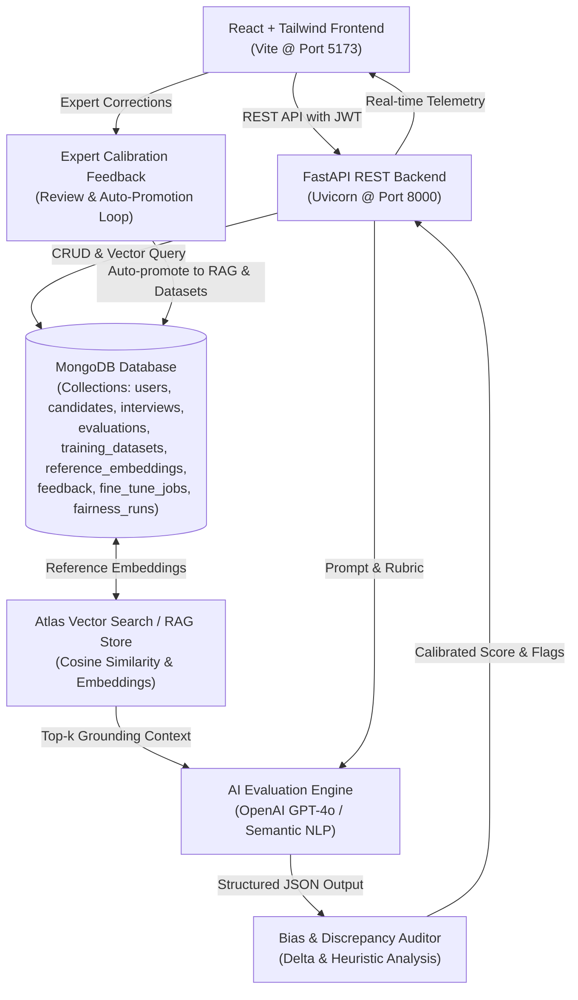

# BiasGuard AI: Unbiased Technical Interview Evaluation & Calibration Platform

[](https://fastapi.tiangolo.com)
[](https://react.dev)
[](https://tailwindcss.com)
[](https://www.mongodb.com)
[](https://openai.com)

**BiasGuard AI** is an AI-assisted technical interview evaluation platform that independently analyzes candidate responses during engineering interviews.

Its primary objective is to identify situations where technically correct or valid alternative candidate answers are unfairly evaluated due to **interviewer bias**, **rigid keyword penalties**, **inconsistent scoring standards**, or **limited domain knowledge**.

---

## 🌟 Key Features

### 1. Dual-Track AI Evaluation Engine
- **Independent Technical Correctness**: Evaluates algorithmic concepts, data structures, and computer science mechanics rather than communication fluency or verbatim buzzwords.
- **Alternative Solution Recognition**: Automatically detects and credits valid non-canonical approaches (e.g. Iterative vs. Recursive, Two-Pointer $O(1)$ space vs. Hash Map $O(n)$ space, Window Functions vs. Correlated Subqueries, Optimistic vs. Pessimistic concurrency).
- **Hybrid Live / Offline Operation**:
  - **Live Mode**: Direct integration with OpenAI (`gpt-4o-mini`, `gpt-4o`, `gpt-3.5-turbo`) returning structured JSON evaluations.
  - **Domain Semantic NLP Engine**: High-fidelity local heuristic and NLP concept extractor that operates without requiring external API keys or cloud credits.

### 2. Discrepancy & Bias Detection
- Evaluates pairwise divergence between the interviewer's score and the AI technical assessment.
- Identifies critical bias patterns:
  - **Overlooked Alternative Approaches** (Candidate valid solution penalized for deviating from interviewer's preferred template)
  - **Strict Keyword / Fluency Penalties** (High technical validity down-scored for phrasing or omitted buzzwords)
  - **Uncalibrated Severity** (Disproportionately low score without technical justification)
  - **Grade Inflation / Halo Effect** (High scores assigned to superficial answers based on superficial rapport)
- Surfaces neutral **"Potential Review Flags"** formulated for engineering calibration committees rather than accusatory accusations.

### 3. Explainable AI Audit Reports
- Complete question-by-question breakdown.
- Itemized lists of:
  - Verified Correct Concepts
  - Valid Alternative Paradigms
  - Factual Errors / Inaccuracies
  - Missing Rubric Components
- Side-by-side score comparison gauges, delta indicators, and recommendations.
- Print / PDF export styling for talent review committees.

### 4. Interactive Analytics & Telemetry Dashboard
- Powered by **Recharts**:
  - Score comparison charts (Interviewer vs. AI technical score scatter and bar graphs)
  - Domain-wise performance metrics (Java, Python, DSA, DBMS, SQL, Operating Systems)
  - Score distribution calibration histogram
  - Discrepancy category breakdown donut chart
  - Full searchable and filterable evaluation history audit log

### 5. Voice-Based Interview & Speech-to-Text Pipeline (New)
- **Candidate Spoken Answers**: Candidates can speak their responses directly into the browser instead of typing.
- **Browser MediaRecorder & Audio Waveform**:
  - Live audio waveform visualizer using Web Audio API (`AudioContext` & `AnalyserNode`).
  - Start, Pause, Resume, Stop, and Re-record controls with recording progress timer (up to 5 min limit).
  - Robust handling of microphone permissions (`NotAllowedError`, `NotFoundError`).
- **OpenAI Whisper Speech-to-Text Integration**:
  - Automatic speech transcription powered by OpenAI Whisper (`whisper-1`) with offline fallback.
  - Interactive transcript review & editing box so candidates can fix typos before submission.
  - Built-in audio player with variable speed playback (1x, 1.25x, 1.5x, 2x) and seek scrubber.
- **Three Flexible Submission Modes**:
  1. ✏️ **Type Answer** (Standard written response)
  2. 🎙️ **Record Voice Answer** (Direct microphone recording)
  3. 📁 **Upload Audio File** (Supports WebM, WAV, MP3, M4A, OGG)
- **Dedicated Candidate Voice Room (`/interviews/:id/candidate-room`)**:
  - Modern, focused voice interface with question navigation, large microphone button, live waveform, and immediate transcript confirmation.
- **Audio Storage & Secure Streaming**:
  - Audio files stored on disk in `backend/uploads/audio/` (never bloated as binary in MongoDB documents).
  - Metadata indexed in MongoDB `audio_recordings` collection.
  - Authenticated streaming endpoint (`/api/voice/audio/{audio_id}`) with HTTP Range header support.
- **Accent & Speaking Speed Invariance**:
  - AI evaluation engine evaluates strictly on computer science substance and engineering logic.
  - Disregards conversational filler words ("um", "ah", "so basically"), accent nuances, speaking speed, or fluency.

### 6. Multi-Role Authentication & Access Control
- Secure password hashing using **bcrypt**.
- **JWT (JSON Web Token)** authorization headers.
- Separate role-based permissions for **Technical Interviewers** and **Hiring Administrators**.
- Built-in 1-click demo login buttons for rapid presentation and testing.

### 7. Candidate Email Invitations & Multi-Device Interview Rooms (New)
- **Time-Limited Unguessable Tokens**: Every candidate receives a cryptographically secure invitation token (`secrets.token_urlsafe(32)`) hashed with SHA-256 before storage in MongoDB.
- **Asynchronous Email Delivery**: Invitations are dispatched in background tasks using SMTP (STARTTLS / Gmail App Passwords / standard mail servers) without blocking API response times.
- **Seamless Candidate Guest Access**: Candidates click the link and enter the interview room directly—no account creation or interviewer login required.
- **Individual Question Audio/Video Recordings**: Candidates can record voice/video answers question by question, with automatic speech-to-text transcription and independent background AI grading.
- **Double-Blind Scoring & Final Comparative Report**: AI scores and explanations remain sealed until the interviewer concludes the session, producing an objective calibration report.

> [!IMPORTANT]
> **Network Configuration for Candidates on Other Devices:**
> For candidates joining from other computers, phones, or over the internet, ensure `FRONTEND_BASE_URL` in `backend/.env` is set to a reachable network address (e.g. your LAN IP `http://192.168.1.X:5173`, a Cloudflare/ngrok tunnel, or your public domain).
> If left configured as `http://localhost:5173`, invitation links will only open on the host machine where the server is running.

---

## 🔬 AI Training & Continuous Improvement Pipeline

BiasGuard AI now features an enterprise-grade AI training, calibration, and continuous improvement pipeline:

### 1. Dataset Management (`/datasets`)
- **Curated Technical Benchmarks**: Store questions, candidate answers, ground-truth labels, expected concepts, and expert explanations across DSA, Python, Java, SQL, DBMS, and OS.
- **Bulk Ingestion**: Full support for JSON and CSV dataset uploads with schema validation, deduplication, and error reporting.
- **Admin Validation & Export**: Administrators can validate training examples and export formatted OpenAI JSONL datasets (`/api/datasets/export/jsonl`).

### 2. Retrieval-Augmented Generation (RAG) Pipeline (`/api/rag`)
- **Semantic Vector Embeddings**: Generates high-dimensional embeddings for expert-approved reference answers.
- **Atlas Vector Search & Dual-Mode Fallback**: Uses native MongoDB Atlas `$vectorSearch` with automatic fallback to high-speed in-memory cosine similarity search when running on local instances.
- **Context Grounding**: Dynamically injects top-$k$ verified reference solutions and Rubrics into the AI prompt to prevent model hallucinations and anchor grading to verifiable standards.

### 3. Human Expert Feedback System (`/feedback`)
- **Calibration Workflows**: Senior technical experts review live evaluations directly from `/interviews/:id/evaluate` or the dedicated `/feedback` dashboard.
- **Non-Destructive Corrections**: Expert scores and rationales are stored separately from original AI predictions with complete audit history.
- **Auto-Promotion Loop**: Verified expert corrections are automatically promoted to `training_datasets` and embedded into the RAG vector store for instant model calibration.

### 4. Model Training & Fine-Tuning Module (`/training`)
- **Dataset Audit & Partitioning**: Validates token lengths, distribution across domains, and generates train/val splits (configurable $80/20$).
- **JSONL OpenAI Format**: Prepares Chat Completion fine-tuning datasets (`{"messages": [{"role": "system"}, {"role": "user"}, {"role": "assistant"}]}`).
- **Fine-Tuning Registry**: Optional integration to trigger, register, and monitor fine-tuning jobs while keeping base LLM and semantic NLP evaluators fully functional.

### 5. Statistical Performance Dashboard (`/performance`)
- **Telemetry & Accuracy**:
  - **MAE** (Mean Absolute Error) & **RMSE** (Root Mean Squared Error)
  - **Classification Accuracy (%)**, Precision, Recall, and F1 Score (across Correct, Partially Correct, and Incorrect classifications)
  - **Evaluation Consistency Score**
- **Interactive Visualizations**:
  - AI Score vs. Expert Score Scatter Plot with ideal calibration line
  - Confusion Matrix
  - Domain-wise accuracy bar chart
  - Model Version & Fine-Tuning History log

### 6. Automated Fairness & Stylistic Invariance Testing (`/fairness`)
- **Counterfactual Style Perturbation**: Evaluates identical technical answers written across 4 distinct stylistic variations:
  - *Academic / Formal* (High vocabulary complexity)
  - *Casual / Conversational* (Colloquial phrasing)
  - *ESL / Non-Native Phrasing* (Grammatically simplified syntax)
  - *Alternative Architectural Paradigm* (e.g., Two-Pointers vs. Hash Map, Window Functions vs. Subqueries)
- **Variance Audit**: Flags score divergences $> 1.5$ points across equivalent answers as potential review flags without definitively claiming bias.

---

## 🏗️ System Architecture



---

## 📁 Repository Structure

```
BIAS-GUARD/
├── backend/
│   ├── app/
│   │   ├── main.py                  # FastAPI initialization, CORS, lifespan
│   │   ├── config.py                # Pydantic environment settings
│   │   ├── database.py              # MongoDB client, collections, indexes
│   │   ├── models/                  # Pydantic schemas (User, Candidate, Interview, Evaluation, Report)
│   │   ├── routes/                  # API routers (auth, candidates, interviews, evaluations, reports, analytics, settings, seed)
│   │   ├── services/
│   │   │   ├── auth_service.py      # bcrypt hashing, JWT issuance & validation
│   │   │   ├── ai_evaluator.py      # OpenAI integration & Offline Semantic NLP Engine
│   │   │   ├── bias_detector.py     # Discrepancy classification & severity scoring
│   │   │   └── analytics_service.py # Metrics aggregation for dashboard
│   ├── .env.example                 # Sample configuration
│   └── requirements.txt             # Backend dependencies
├── frontend/
│   ├── src/
│   │   ├── components/              # Layout, Navbar, Sidebar, Badges
│   │   ├── context/                 # AuthContext (JWT) & ThemeContext (Dark/Light)
│   │   ├── pages/                   # Landing, Login, Dashboard, Create Interview, Evaluation, Candidates, Reports, Analytics, Settings
│   │   ├── services/api.js          # Centralized Axios client with JWT interceptors
│   │   ├── App.jsx                  # React Router configuration
│   │   └── main.jsx                 # Entry point
│   ├── tailwind.config.js           # Theme and styling rules
│   ├── vite.config.js               # Vite proxy to FastAPI backend
│   └── package.json                 # Frontend dependencies
├── ai/
│   └── resume_parsing/llm/
│       └── evaluate_answer.py       # Standalone CLI / Python module for answer evaluation
└── README.md                        # Project documentation
```

---

## 🚀 Quickstart Guide

### Prerequisites
1. **Python 3.10+** (Tested on Python 3.10 through 3.14)
2. **Node.js v18+** & **npm**
3. **MongoDB** (Local instance on `mongodb://localhost:27017` or a free MongoDB Atlas connection string)

---

### Step 1: Backend Setup

1. Open a terminal and navigate to the `backend` folder:
   ```bash
   cd backend
   ```

2. Create and activate a Python virtual environment:
   ```bash
   # Windows (PowerShell)
   python -m venv .venv
   .\.venv\Scripts\Activate.ps1

   # macOS / Linux
   python3 -m venv .venv
   source .venv/bin/activate
   ```

3. Install dependencies:
   ```bash
   pip install -r requirements.txt
   ```

4. Create your `.env` file:
   ```bash
   cp .env.example .env
   ```
   *(Optional)* If you have an OpenAI API key, paste it into `.env`. If left empty, BiasGuard AI automatically runs in its intelligent offline semantic NLP mode.

5. Start the FastAPI backend server:
   ```bash
   uvicorn app.main:app --host 127.0.0.1 --port 8000 --reload
   ```
   The backend will be live at `http://127.0.0.1:8000`.  
   Interactive Swagger API Documentation: `http://127.0.0.1:8000/docs`.

> [!TIP]
> **One-Click Startup & UTF-8 Encoding Configuration (Windows PowerShell):**
> You can launch both backend and frontend concurrently with automated health checks using:
> ```powershell
> .\start-dev.ps1
> ```
> To stop both development servers cleanly, run `.\stop-dev.ps1`.
> On Windows, `start-dev.ps1` automatically exports `$env:PYTHONUTF8 = "1"` and `$env:PYTHONIOENCODING = "utf-8"` before launching the backend. If starting Uvicorn manually in Windows PowerShell, set these environment variables (`$env:PYTHONUTF8 = "1"; $env:PYTHONIOENCODING = "utf-8"`) to ensure stdout and redirected logs handle UTF-8 cleanly and prevent `charmap` / `cp1252` encoding errors (`UnicodeEncodeError`).

---

### Step 2: Frontend Setup

1. Open a second terminal and navigate to the `frontend` folder:
   ```bash
   cd frontend
   ```

2. Install dependencies:
   ```bash
   npm install
   ```

3. Start the Vite development server:
   ```bash
   npm run dev
   ```
   The application will be accessible at: **`http://127.0.0.1:5173/`**.

---

## 📱 Candidates on Other Devices (Remote / Mobile / Cross-Network Setup)

When interviewing candidates joining from a different laptop, smartphone (iOS / Android), or remote network outside your local machine, the browser and LiveKit need to reach your frontend and backend securely.

### 1. Expose the Frontend via Cloudflare Tunnel
Modern mobile browsers (Safari on iOS, Chrome on Android) require an **HTTPS** context to grant access to cameras and microphones. Cloudflare Tunnel provides an instant, free, secure HTTPS URL without opening router ports:

1. Install [Cloudflare `cloudflared`](https://developers.cloudflare.com/cloudflare-one/connections/connect-networks/downloads/) on your host machine.
2. Run the tunnel command in a new terminal window:
   ```bash
   cloudflared tunnel --url http://127.0.0.1:5173
   ```
3. Copy the generated public HTTPS URL from the terminal output (for example: `https://example-random-subdomain.trycloudflare.com`).

> [!NOTE]
> Every time you restart `cloudflared tunnel` without a named tunnel configuration, a new random subdomain is assigned. Whenever the tunnel restarts, you must update `FRONTEND_BASE_URL` in `backend/.env` and resend invitations.

### 2. Configure `FRONTEND_BASE_URL` in `backend/.env`
Open `backend/.env` and update `FRONTEND_BASE_URL` to match your active public tunnel URL:
```ini
FRONTEND_BASE_URL=https://example-random-subdomain.trycloudflare.com
```

### 3. Restart the Backend & Development Servers
Restart your backend server so it loads the new origin and generates email links pointing to the public tunnel:
```powershell
.\stop-dev.ps1
.\start-dev.ps1
```
*(Or restart Uvicorn if running services manually).*

### 4. Send or Resend Candidate Invitations
From the interviewer dashboard, click **"Send Invitation Email"** (or **"Resend Email"**). The invitation link will now be generated with your public HTTPS tunnel URL. The candidate can open the email on their phone or remote laptop and join immediately.

---

### 🛠️ Troubleshooting Cross-Device Interviews

| Issue / Symptom | Root Cause | Fix / Resolution |
|---|---|---|
| **"Camera & Microphone Access Denied" on phone** | Mobile browsers block media devices over plain HTTP | Always access via HTTPS (e.g. Cloudflare tunnel `https://*.trycloudflare.com`). In Safari on iOS or Chrome on Android, tap the URL bar icon to allow camera and mic permissions. |
| **"Could not establish signal connection: invalid token"** | LiveKit credentials or room configuration mismatch | Verify that `LIVEKIT_URL`, `LIVEKIT_API_KEY`, and `LIVEKIT_API_SECRET` are set in `backend/.env`. Both interviewer and candidate automatically join the canonical shared room `interview_<id>`. |
| **"Your session expired. Please reopen your invitation link."** | The 30-minute join window expired before clicking Accept | The join window (`INVITATION_EXPIRY_MINUTES=30`) protects unaccepted links. Have the interviewer click "Resend Email". Once accepted, the session remains active for up to 3 hours (`SESSION_MAX_MINUTES=180`). |
| **"Network Error" or blank page on candidate's phone** | `FRONTEND_BASE_URL` points to `localhost` or old tunnel | Ensure `FRONTEND_BASE_URL` in `backend/.env` matches the current `cloudflared` tunnel URL, and that `Vite` was started with tunnel domain support (included by default in `vite.config.js`). |
| **Audio recording fails to upload on iOS Safari** | Safari records audio in MP4/AAC containers instead of WebM | BiasGuard automatically detects browser codec support, records in `audio/mp4` on iOS, and transcribes via Whisper without any manual settings needed. |
| **Phone screen turns off during long answers** | Mobile device auto-sleep / lock screen | BiasGuard AI activates the Screen Wake Lock API automatically while in the interview room. Keep the tab open and do not switch away from the browser during recording. |
| **Weak cellular network or dropped live video** | Bandwidth congestion on candidate device | BiasGuard AI automatically reconnects video, or gracefully falls back to `"Recorded-Answer Mode"` so the candidate can complete the interview uninterrupted. |

---

## 🧪 Automated Testing

BiasGuard AI includes an automated test suite covering unit logic, RAG vector similarity, training message formatting, statistical metrics calculation, fairness suites, and REST endpoints:

```bash
cd backend
$env:PYTHONPATH = "c:\Users\BIT\Desktop\BIAS-GUARD\backend"
.\.venv\Scripts\pytest.exe tests -v
```

All 18 tests validate:
- ✅ Health check, RAG engine, and Voice status (`/api/health`)
- ✅ Datasets CRUD, validation, and JSON/CSV bulk file uploads
- ✅ Performance metrics (MAE, RMSE, confusion matrix, accuracy)
- ✅ Fairness benchmark and stylistic variance detection
- ✅ OpenAI fine-tuning dataset formatting and JSONL generation
- ✅ RAG vector embedding cosine similarity and semantic retrieval
- ✅ Voice audio recording upload, Whisper transcription, and HTTP streaming
- ✅ Audio file size & format validation (WebM, WAV, MP3, OGG, M4A)
- ✅ Spoken vs. typed answer technical scoring equivalence (accent & fluency invariance)
- ✅ Multiple recording attempts and candidate transcript editing

---

## 🔑 Default Demonstration Credentials

BiasGuard AI comes pre-seeded with realistic interview scenarios demonstrating bias detection in action:

| Role | Email | Password |
|---|---|---|
| **Technical Interviewer** | `interviewer@biasguard.ai` | `password123` |
| **Administrator / Lead** | `admin@biasguard.ai` | `admin123` |

*(You can also use the 1-click demo login buttons directly on the login page).*

---

## 🧪 Demonstration Scenarios Included

When you open the platform, the following pre-loaded cases illustrate how BiasGuard AI safeguards talent:

1. **Scenario 1: Overlooked Alternative Approach (DSA / Two-Pointers vs. Hash Map)**
   - *Question*: Find two numbers that sum to target with memory trade-offs.
   - *Candidate*: Solved using sorted Two-Pointers to guarantee strict $O(1)$ space on memory-constrained systems.
   - *Interviewer Score*: **3.5 / 10** ("Candidate didn't use Hash Map as asked").
   - *BiasGuard AI*: **8.6 / 10** • **Flag**: *Alternative Approach Overlooked (High Severity)*.

2. **Scenario 2: Strict Keyword / Fluency Bias (Python / GIL)**
   - *Question*: Explain the CPython Global Interpreter Lock and CPU parallelism.
   - *Candidate*: Explained the memory tracking mechanism accurately in plain English.
   - *Interviewer Score*: **4.5 / 10** ("Too casual, didn't say 'reference counting' in opening sentence").
   - *BiasGuard AI*: **8.4 / 10** • **Flag**: *Strict Keyword / Terminology Bias*.

3. **Scenario 3: Calibrated Parity (Java / HashMap Internals)**
   - *Question*: Explain collision handling in Java 8+ and the equals/hashCode contract.
   - *Candidate*: Accurate treeification explanation and contract violation analysis.
   - *Interviewer Score*: **9.0 / 10** • *BiasGuard AI*: **9.4 / 10** • **Status**: *Calibrated & Consistent*.

4. **Scenario 4: Grade Inflation / Halo Effect (DBMS / Normalization)**
   - *Question*: Normalization 1NF to BCNF and de-normalization trade-offs.
   - *Candidate*: Vague, colloquial answer omitting functional dependencies and BCNF.
   - *Interviewer Score*: **8.5 / 10** ("Candidate has fantastic presence and graduated from top school").
   - *BiasGuard AI*: **4.6 / 10** • **Flag**: *Lenient Calibration / Halo Effect*.

---

## 💻 Standalone AI Evaluation CLI

You can also run independent answer evaluations directly from the command line:

```bash
python ai/resume_parsing/llm/evaluate_answer.py \
  --domain "DSA" \
  --question "How to find two numbers that sum to target with O(1) auxiliary space?" \
  --answer "Sort the array and use a two-pointer pass from both ends moving inward." \
  --criteria "Two pointer pass" "O(1) space" \
  --interviewer-score 3.0 \
  --notes "Didn't use hash map"
```

Output:
```json
{
  "technical_score": 8.5,
  "correct_concepts": [
    "Addressed: Two pointer pass",
    "Addressed: O(1) space",
    "Applied two-pointer traversal reducing space overhead"
  ],
  "incorrect_concepts": [],
  "missing_concepts": [
    "Asymptotic complexity bounds (Big-O analysis) not explicitly stated"
  ],
  "alternative_valid_approaches": [
    "Hash table approach trading space for constant time lookup"
  ],
  "explanation": "Evaluated candidate response for DSA technical depth...",
  "potential_discrepancy": true,
  "review_recommendation": "Flagged for Secondary Review: Candidate demonstrated sound technical logic...",
  "discrepancy_details": {
    "detected": true,
    "type": "UNDER_EVALUATED_ALTERNATIVE",
    "severity": "HIGH",
    "score_delta": -5.5,
    "bias_category": "Alternative Approach Overlooked"
  }
}
```

---

## 🛡️ License

This project is developed for educational and portfolio demonstration purposes. All rights reserved © 2026 BiasGuard AI.
